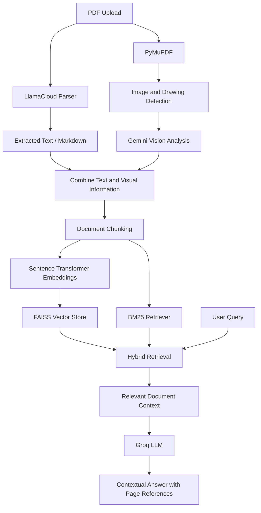

# 🔬 ResearchLens — Multimodal Research Paper Assistant

\<p align="center">
&#x20; \<strong>Understand research papers through intelligent conversations.\</strong>
\</p>

\<p align="center">   A multimodal Retrieval-Augmented Generation (RAG) application that combines document parsing, visual understanding, semantic search, and keyword retrieval to make research papers easier to explore. \</p>

\<p align="center">   \<a href="[https://researchlens-kitf3mbd3e5ufbspadjvjg.streamlit.app/](https://researchlens-kitf3mbd3e5ufbspadjvjg.streamlit.app/)">🚀 Live Demo\</a> •   \<a href="[https://github.com/nirwaniadhau/ResearchLens](https://github.com/nirwaniadhau/ResearchLens)">GitHub Repository\</a> \</p>

---

## 📌 Overview

ResearchLens is an AI-powered research paper assistant that allows users to upload academic PDFs and interact with their contents through natural-language conversations.

Traditional PDF readers primarily provide text search, making it difficult to understand complex research papers containing technical explanations, tables, charts, graphs, and diagrams.

ResearchLens addresses this challenge through a **multimodal RAG architecture** that processes both textual and visual information before making it available for retrieval and question answering.

Users can upload a research paper, ask questions about its methodology, findings, contributions, and technical details, and receive context-aware answers with relevant page references.

## ✨ Key Features

### 📄 1. Multimodal PDF Processing

- Parses research papers using LlamaCloud.
- Extracts page-level text and Markdown content.
- Uses PyMuPDF to detect images and vector drawings.
- Integrates Google Gemini for visual analysis of meaningful figures, diagrams, and charts.
- Combines extracted text and visual descriptions into structured documents.

### 🧩 2. Intelligent Document Chunking

- Uses RecursiveCharacterTextSplitter.
- Creates overlapping chunks to preserve contextual continuity.
- Maintains page-level metadata for source references.
- Prepares structured documents for embedding and retrieval.

### 🔍 3. Hybrid Information Retrieval

ResearchLens combines semantic and keyword-based retrieval to identify relevant information from research papers.

**Semantic Search — FAISS**

- Generates dense vector embeddings using Sentence Transformers.
- Uses `all-MiniLM-L6-v2`.
- Retrieves semantically related document chunks.

**Keyword Search — BM25**

- Retrieves documents based on keyword relevance.
- Helps identify exact technical terms, names, and numerical references.

**Hybrid Retrieval**

- Combines FAISS and BM25 using LangChain's EnsembleRetriever.
- Uses weighted retrieval to leverage both semantic and lexical matching.

### 🤖 4. Conversational Question Answering

- Uses retrieved document context to generate answers.
- Integrates Groq for LLM-based response generation.
- Supports conversational follow-up questions using chat history.
- Provides relevant page references.
- Uses a context-grounded prompt to reduce unsupported answers.

### 💻 5. Interactive Web Interface

- Built using Streamlit.
- Supports PDF uploads.
- Displays document processing status.
- Provides a conversational chat interface.
- Includes suggested questions and chat history.

---

## 🏗️ System Architecture

ResearchLens follows a multimodal Retrieval-Augmented Generation architecture with separate ingestion, retrieval, and generation stages.



## ⚙️ How It Works

### 1. Document Ingestion

When a user uploads a PDF:

1. LlamaCloud parses the document and extracts page-level Markdown.
2. PyMuPDF identifies images and vector drawings.
3. Gemini analyzes meaningful visual content.
4. Extracted text and visual descriptions are combined into structured documents.

### 2. Document Preparation

1. Documents are split into overlapping chunks.
2. Page metadata is preserved.
3. Sentence Transformers generates dense embeddings.
4. The resulting documents are indexed in FAISS.
5. BM25 builds a keyword-based retrieval index.

### 3. Hybrid Retrieval

When a user asks a question:

1. FAISS retrieves semantically relevant chunks.
2. BM25 retrieves keyword-relevant chunks.
3. LangChain's EnsembleRetriever combines the results.
4. Relevant document context is passed to the generation pipeline.

### 4. Answer Generation

1. The user's question and recent conversation history are considered.
2. Retrieved document chunks are formatted into the prompt.
3. Groq generates a response using the provided research-paper context.
4. The answer includes relevant page references.

---

## 🛠️ Technology Stack

| Category             | Technology                |
| -------------------- | ------------------------- |
| Programming Language | Python                    |
| Frontend             | Streamlit                 |
| PDF Parsing          | LlamaCloud                |
| Visual Processing    | PyMuPDF                   |
| Vision Model         | Google Gemini             |
| Embedding Model      | Sentence Transformers     |
| Embedding Model Name | all-MiniLM-L6-v2          |
| Vector Database      | FAISS                     |
| Keyword Retrieval    | BM25                      |
| RAG Orchestration    | LangChain                 |
| LLM Inference        | Groq                      |
| Deployment           | Streamlit Community Cloud |

---

## 📊 Retrieval Evaluation

ResearchLens includes an evaluation dataset to compare the performance of different retrieval strategies.

The following results were recorded on 29 answerable evaluation queries.

| Retrieval Strategy   |  Recall\@1 | Recall\@3 |
| -------------------- | ---------: | --------: |
| FAISS                |     62.07% |    93.10% |
| BM25                 |     58.62% |    89.66% |
| **Hybrid Retrieval** | **79.31%** |  **100%** |

### Key Observations

- FAISS provides semantic retrieval based on contextual similarity.
- BM25 complements semantic search by matching important keywords.
- Hybrid retrieval achieved the highest Recall\@1 among the evaluated approaches.
- Hybrid retrieval achieved 100% Recall\@3 on this evaluation set.

These results demonstrate the benefit of combining semantic and lexical retrieval for research-paper question answering.

*Note: These are retrieval metrics, not end-to-end answer accuracy or faithfulness measurements.*

---

## 📂 Project Structure

```text
ResearchLens/
│
├── .streamlit/
│   └── config.toml
│
├── app/
│   ├── ingestion/
│   │
│   ├── retrieval/
│   │
│   ├── generation/
│   │   └── llm.py
│   │
│   ├── evaluation/
│   │   ├── answer_eval.py
│   │   └── retrieval_eval.py
│   │
│   ├── pipeline.py
│   └── main.py
│
├── data/
├── evaluation/
├── tests/
│
├── evaluation_dataset.json
├── requirements.txt
├── streamlit_app.py
└── README.md
```

---

## 🚀 Installation and Setup

Follow these steps to run ResearchLens locally.

### Prerequisites

- Python 3.10 or higher
- Git
- API keys for LlamaCloud, Google Gemini, and Groq

### 1. Clone the Repository

```bash
git clone https://github.com/nirwaniadhau/ResearchLens.git

cd ResearchLens
```

### 2. Create a Virtual Environment

**Windows:**

```powershell
python -m venv .venv

.venv\Scripts\activate
```

**Linux / macOS:**

```bash
python -m venv .venv

source .venv/bin/activate
```

### 3. Install Dependencies

```bash
pip install -r requirements.txt
```

### 4. Configure Environment Variables

Create a `.env` file in the project root directory.

Add your API credentials:

```env
LLAMA_CLOUD_API_KEY=your_llama_cloud_api_key

GEMINI_API_KEY=your_gemini_api_key

GROQ_API_KEY=your_groq_api_key
```

**Important:** Never commit your `.env` file or expose your API credentials publicly.

### 5. Run the Application

```bash
streamlit run streamlit_app.py
```

Open the local URL displayed in the terminal to access ResearchLens.

---

## 💬 Example Questions

After uploading a research paper, users can ask questions such as:

- What is the main objective of this research?
- What problem does the proposed methodology address?
- What are the key contributions of this paper?
- Explain the architecture of the proposed system.
- What datasets were used in the experiments?
- What performance metrics were reported?
- What are the limitations of the proposed approach?
- Explain the important diagrams and figures in the paper.

---

## 🔮 Future Improvements

- Fault-tolerant multimodal ingestion with improved API retry and fallback handling.
- Cross-encoder reranking to improve retrieval relevance.
- More comprehensive RAG evaluation using faithfulness and answer-relevance metrics.
- Clickable citations with supporting PDF page previews.
- Multi-document question answering and research-paper comparison.
- Automated unit and integration testing.
- Improved extraction of complex tables, charts, and diagrams.

---

## ⚠️ Current Limitations

- Document parsing and visual analysis depend on external API availability and quotas.
- Processing large documents may take longer depending on document complexity and API response times.
- Visual understanding may be limited for complex diagrams or low-quality scanned pages.
- LLM-generated responses should be verified against the original research paper.
- Uploaded documents are processed for the active application session; persistent document storage is not currently provided.

---

## 👨‍💻 Author

**Nirwani Adhau**

Computer Science Engineering Student
Vishwakarma Institute of Technology, Pune

- GitHub: [@nirwaniadhau](https://github.com/nirwaniadhau)
- Project: [ResearchLens](https://github.com/nirwaniadhau/ResearchLens)
- Live Application: [Try ResearchLens](https://researchlens-kitf3mbd3e5ufbspadjvjg.streamlit.app/)

---

\<p align="center">
&#x20; \<strong>ResearchLens — Making research papers easier to understand through AI.\</strong>
\</p>
